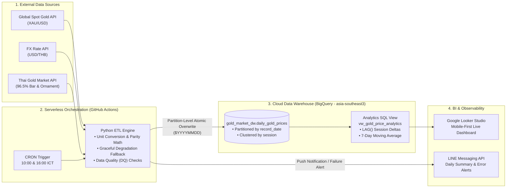

# 🪙 Automated Thai & Global Gold Price ETL Pipeline, LINE Alerting & Live BI Dashboard

[](https://www.python.org/)
[](https://cloud.google.com/bigquery)
[](https://github.com/features/actions)
[](https://lookerstudio.google.com/)
[](https://developers.line.biz/)

An end-to-end, serverless **Data Engineering pipeline** that extracts real-time global spot gold prices (`XAU/USD`), foreign exchange rates (`USD/THB`), and domestic Thai Gold Traders Association prices twice daily—transforming them into financial parity metrics, loading them idempotently into **Google BigQuery**, delivering automated reports via **LINE Messaging API**, and visualizing trends on a mobile-first **Looker Studio** dashboard.

🔗 **[View Live Interactive Dashboard (Looker Studio)](https://datastudio.google.com/reporting/33573a5b-3d14-4a8c-9b20-ef507ab08ca1)**

---

## 📌 Business Motivation & Problem Statement

Domestic gold prices in Thailand (96.5% purity, 15.244g per Baht-weight) are heavily influenced by global spot gold (`XAU/USD` per troy ounce) and the `USD/THB` exchange rate, yet local market prices often carry a domestic supply-demand spread (premium/discount).

This project was engineered to solve two practical needs:
1. **Family Financial Utility:** Deliver automated, easy-to-read morning (`10:00 ICT`) and afternoon (`16:00 ICT`) gold price summaries and trend charts directly to family members' mobile phones via LINE.
2. **Market Parity & Spread Analysis:** Quantify the exact spread (`thai_market_premium_thb`) between local Thai gold bar prices and theoretical global parity prices.

---

## 🏗️ System Architecture



---

## ⚙️ Key Data Engineering Highlights

* **Idempotent Ingestion on BigQuery Sandbox (Zero-Billing Architecture):**
  BigQuery Sandbox restricts DML statements (`DELETE`, `MERGE`, `UPDATE`). To guarantee idempotency without incurring cloud billing costs, the pipeline implements a **Partition-Level Atomic Overwrite (`daily_gold_prices$YYYYMMDD` with `WRITE_TRUNCATE`)**—fetching existing intra-day sessions via `SELECT`, merging with the newly extracted session in Python, and atomically replacing only the target day's partition.
* **Graceful Degradation & Fault Tolerance:**
  If the third-party Thai domestic gold API experiences downtime or latency, the pipeline does not crash. Instead, it logs a `DEGRADED` status, preserves valid global parity metrics (`XAU/USD`, `USD/THB`, `global_calc_965_thb`), and ingests the partial record cleanly so historical continuity is maintained.
* **Automated Data Quality (DQ) Gates:**
  Pre-load validation assertions verify non-null constraints, positive pricing bounds, and realistic `USD/THB` exchange rate thresholds before writing to the warehouse. Any pipeline or DQ failure immediately triggers a formatted stack-trace alert to LINE.
* **Warehouse Storage & Query Optimization:**
  * Deployed in `asia-southeast3 (Bangkok)` to minimize BI query latency and align with local data residency.
  * Partitioned by `record_date` (DAY) and clustered by `session` to minimize bytes scanned.
* **Analytical Modeling (`vw_gold_price_analytics`):**
  * Resolves alphabetical sorting traps (`'AFTERNOON' < 'MORNING'`) using explicit `session_order` keys and logical timestamps (`10:00` / `16:00`).
  * Computes session-over-session price deltas using `LAG()` window functions, 7-day rolling averages (`ROWS BETWEEN 13 PRECEDING AND CURRENT ROW`), and dynamic `LATEST` flags via `ROW_NUMBER()` for BI scorecard filtering.
* **Zero-Trust Secret Management:**
  All GCP Service Account keys and LINE tokens are stored in encrypted GitHub Secrets. Service account JSON credentials are materialized ephemerally at runtime and purged unconditionally via `if: always()` cleanup steps.

---

## 🗄️ Data Warehouse Schema

### Fact Table: `gold_market_dw.daily_gold_prices`

| Column Name | Data Type | Mode | Description |
| :--- | :--- | :--- | :--- |
| `record_date` | `DATE` | `REQUIRED` | Partition key (Asia/Bangkok business date) |
| `session` | `STRING` | `REQUIRED` | Cluster key (`MORNING` or `AFTERNOON`) |
| `xau_usd_oz` | `FLOAT64` | `REQUIRED` | Global spot gold price (USD per troy ounce) |
| `usd_thb_rate` | `FLOAT64` | `REQUIRED` | Spot exchange rate (THB per 1 USD) |
| `global_calc_965_thb` | `FLOAT64` | `REQUIRED` | Theoretical Thai 96.5% gold price derived from global spot |
| `thai_bar_buy_thb` | `FLOAT64` | `NULLABLE` | Domestic gold bar buy-in price (THB per Baht-weight) |
| `thai_bar_sell_thb` | `FLOAT64` | `NULLABLE` | Domestic gold bar sell-out price (THB per Baht-weight) |
| `thai_ornament_buy_thb` | `FLOAT64` | `NULLABLE` | Domestic gold ornament buy-in price (THB) |
| `thai_ornament_sell_thb` | `FLOAT64` | `NULLABLE` | Domestic gold ornament sell-out price (THB) |
| `thai_market_premium_thb` | `FLOAT64` | `NULLABLE` | Spread (`thai_bar_sell_thb - global_calc_965_thb`) |
| `thai_api_status` | `STRING` | `REQUIRED` | Pipeline health indicator (`SUCCESS` or `DEGRADED`) |
| `ingested_at` | `TIMESTAMP` | `REQUIRED` | UTC ingestion audit timestamp |

---

## 📂 Project Structure

```text
automated-gold-price-pipeline/
├── .github/
│   └── workflows/
│       └── daily_pipeline.yml        # Scheduled CRON & manual workflow_dispatch
├── docs/                             # Dashboard & LINE notification screenshots
├── sql/
│   ├── 01_create_tables.sql          # DDL for partitioned & clustered BigQuery table
│   └── 02_create_analytics_view.sql  # Analytical view with window functions & KPI flags
├── src/
│   └── etl_gold_price.py             # Core ETL, DQ checks, idempotent loader & LINE bot
├── .env.example                      # Template for required environment variables
├── .gitignore                        # Excludes .venv, .env, and gcp-key.json
├── requirements.txt                  # Pinned Python dependencies
└── README.md                         # Project documentation
```

---

## 🚀 Setup & Local Development

### 1. Clone & Configure Virtual Environment
```bash
git clone [https://github.com/66070002-Krittee/automated-gold-price-pipeline.git](https://github.com/66070002-Krittee/automated-gold-price-pipeline.git)
cd automated-gold-price-pipeline

python -m venv .venv
# Windows PowerShell:
.\.venv\Scripts\Activate.ps1
# macOS/Linux:
source .venv/bin/activate

pip install -r requirements.txt
```

### 2. Provision BigQuery Resources
1. Create a dataset named `gold_market_dw` in region `asia-southeast3`.
2. Execute `sql/01_create_tables.sql` and `sql/02_create_analytics_view.sql` in BigQuery Studio.
3. Create a Service Account with `BigQuery Data Editor` and `BigQuery Job User` roles, and download the JSON key as `gcp-key.json`.

### 3. Configure Environment Variables
Copy `.env.example` to `.env` and populate your credentials:
```env
GCP_PROJECT_ID=your-gcp-project-id
GOOGLE_APPLICATION_CREDENTIALS=gcp-key.json
LINE_CHANNEL_ACCESS_TOKEN=your-line-channel-access-token
LINE_USER_ID=your-line-user-id
LOOKER_DASHBOARD_URL=your-public-looker-studio-url
```

### 4. Run Pipeline Locally
```bash
python src/etl_gold_price.py
```

---

## 📸 Dashboard & Alert Preview

| LINE Automated Report | Looker Studio Mobile Dashboard |
| :---: | :---: |
|  |  |

---

